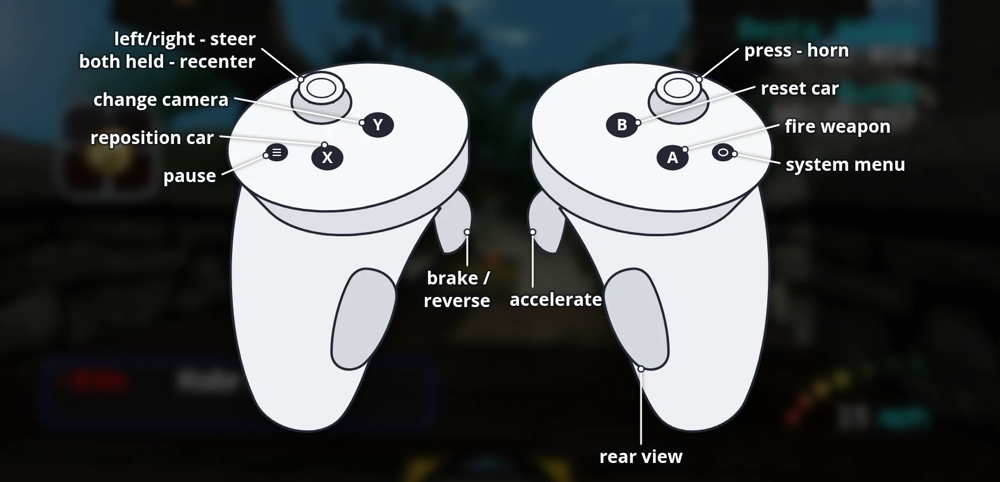

# RVGL-VR

**Download, install guide, controls and pictures: [portroyale.online/rvgl.html](https://portroyale.online/rvgl.html)**

**Re-Volt (RVGL) for Meta Quest and PICO, standalone.** The official RVGL Android engine in
a native OpenXR host: menus on a big virtual screen, and races in head-tracked
stereo 3D with the HUD on a floating panel. It plays with the Touch controllers.

- Engine: [RVGL](https://rvgl.org) 23.1030a1, the official Android build (unmodified `libmain.so`)
- VR host: a native OpenXR layer built into SDL2 (`jni/questxr`)
- Tested on Meta Quest 3. PICO 4 / 4 Ultra / Neo 3 use the same APK (untested; PICO OS 5.9.0 or newer)

## Install

1. Install the APK from the [releases](https://github.com/SgtBilko76/RVGL-VR/releases)
   with SideQuest, or run `adb install -r RVGL-VR-v0.1.1.apk` (on PICO use adb).
2. Start **RVGL VR** from *Library → Unknown Sources*.
3. On the first start a setup panel opens:
   - **Allow file access** → switch it on → *Done*. RVGL keeps its data in `/sdcard/RVGL`.
   - **Download and install** fetches about 225 MB from the official sources:
     - Re-Volt game files and soundtrack from [Re-Volt I/O](https://re-volt.io)
     - the [RV 25th Anniversary pack](https://www.revoltworld.net/dl/rv25-pack/) from Re-Volt World
   - The game then starts by itself. Later starts go straight into VR.

Already have RVGL data, for example from the Android version? Copy it to `/sdcard/RVGL`.
Packs that are already there are not downloaded again.

## Controls



| Controller (Quest Touch / PICO) | Race | Menus |
|---|---|---|
| Left stick | Steer | Move / turn the name wheel |
| Right trigger | Accelerate | |
| Left trigger | Brake / reverse | |
| A | Fire weapon | Select / add letter |
| B | Reset car | Back |
| X | Reposition car | |
| Y | Change camera | |
| Right grip | Rear view | |
| Right stick click | Horn | |
| Left menu button | Pause | Back |
| Hold both stick clicks 1 s | Re-centre the view | Re-centre the view |

New profiles get this layout automatically. You can still change it in RVGL's own
controller settings.

## Building

Requirements: Android SDK with NDK 25.1.8937393, JDK 17, Python 3.

```
git clone https://github.com/SgtBilko76/RVGL-VR.git && cd RVGL-VR
git clone https://gitlab.com/re-volt/rvgl-base.git     # RVGL's own assets (fonts, shaders, strings)
./gradlew assembleRelease
```

- `jni/questxr/` – OpenXR host: virtual screen, stereo, HUD panel, Touch → virtual gamepad
- `tools/patch_sdl.py` – idempotent hooks into the bundled SDL 2.0.20 copy
- `src/main/java/com/bilko/rvglvr/SetupActivity.java` – first-launch download panel
- `tools/quest_run.sh`, `tools/script_run.sh` – build/install/launch with scripted input and headset screenshots

## Licences and credits

- **RVGL** © the RVGL team ([rvgl.org](https://rvgl.org)). The redistributable engine
  (`src/main/jniLibs`) is licensed under CC BY-NC-SA 4.0. Licence texts are in the APK
  under `assets/licenses` and are copied to `/sdcard/RVGL/licenses`.
- **Re-Volt** © Acclaim / WeGo Interactive. No game data is included. It is downloaded
  from the community's official sources on first start.
- **RV 25th Anniversary pack**: the Re-Volt community, compiled by Crimson Fury. Each
  car and track belongs to its author; see the readme files in `/sdcard/RVGL/packs/rv25`.
- SDL2 and SDL2_image (zlib licence), OpenXR loader (Apache 2.0).
- VR port by SgtBilko76 ([portroyale.online](https://portroyale.online)). Unofficial,
  not affiliated with the RVGL team or WeGo Interactive. Free and non-commercial.
